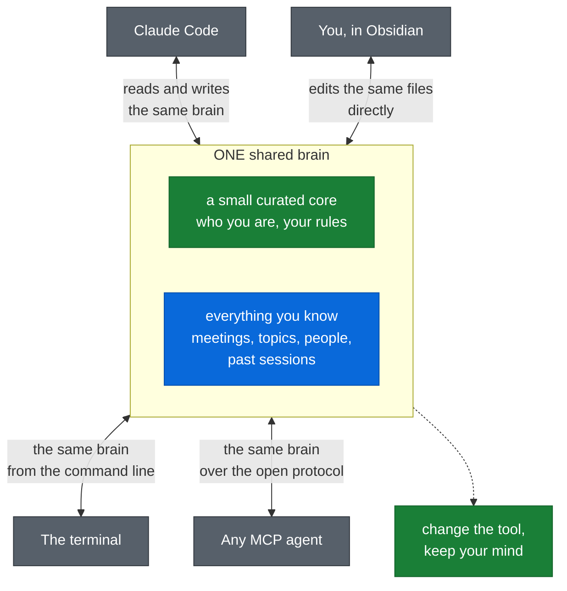
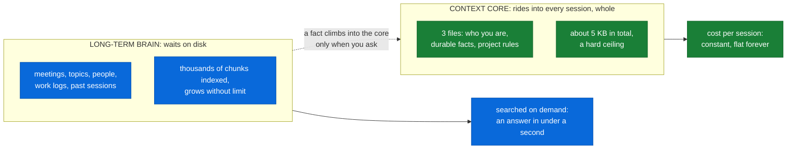
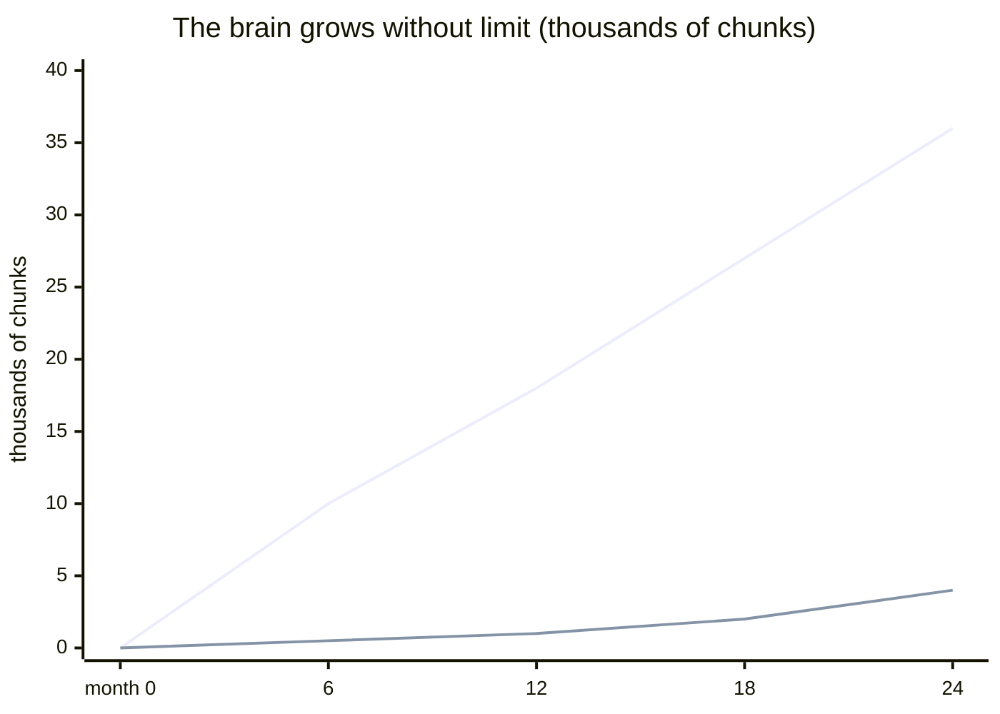
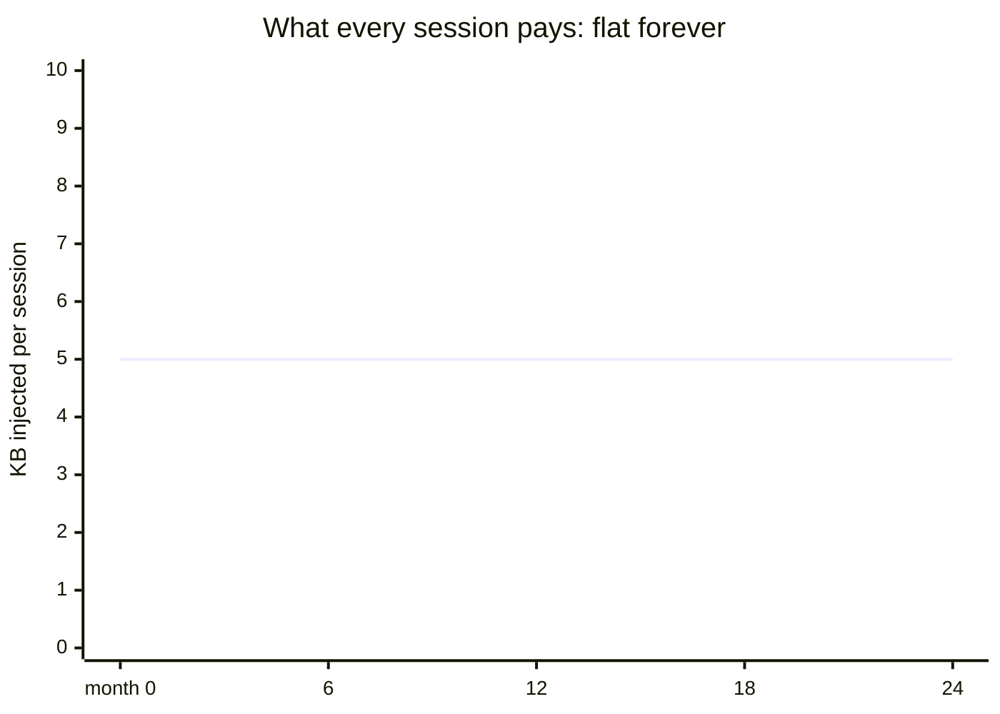
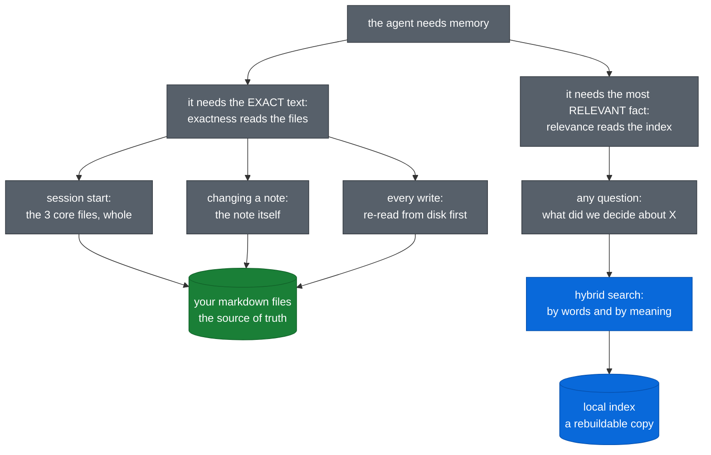
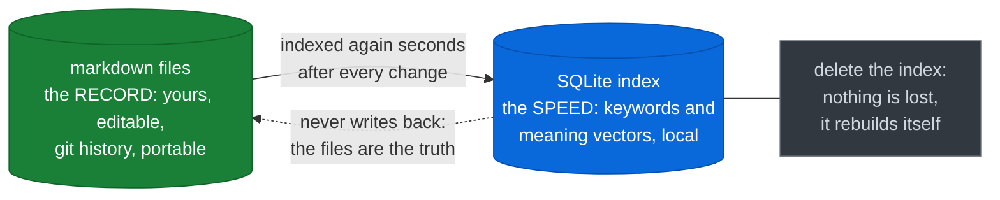
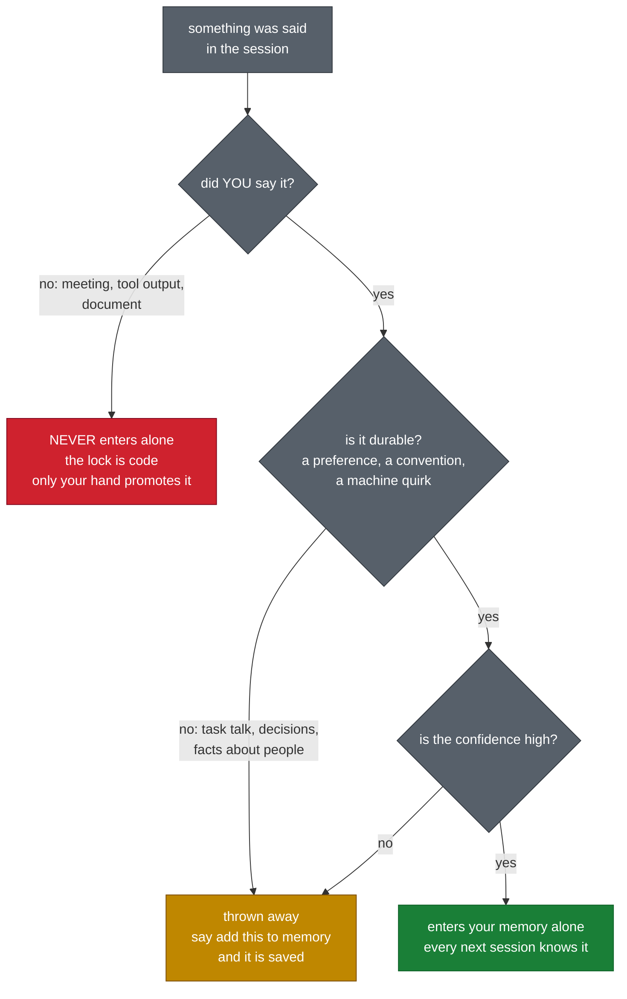
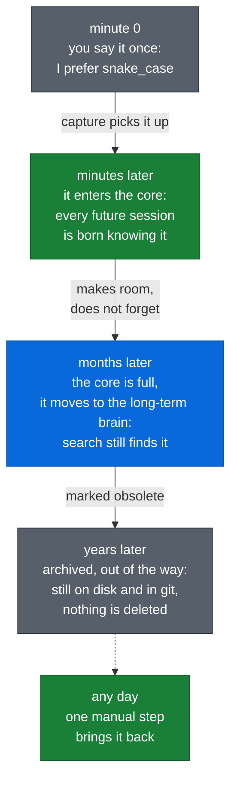
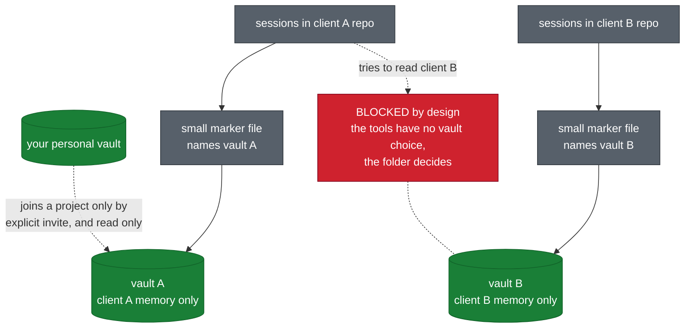
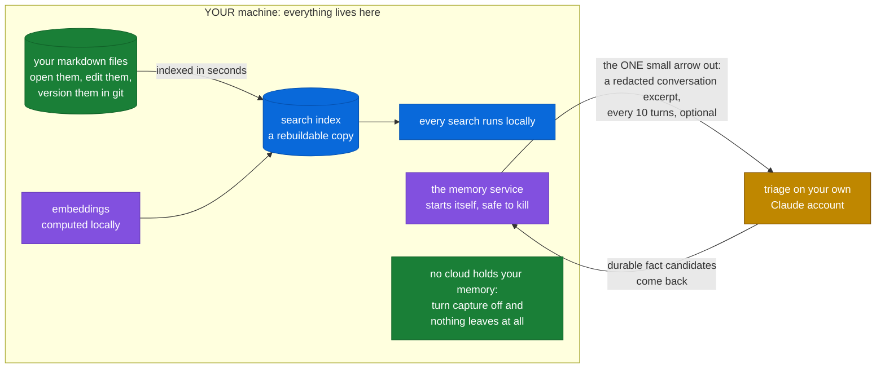

# A second brain for your AI agents

Your AI already remembers a little. Claude Code keeps notes about your
preferences per project, plus a global instruction file. All of it lives
inside one tool, and none of it is your knowledge. What no
assistant gives you is a brain: your meetings, your people, your
decisions, and your past work, searchable by meaning, shared by every tool
you use, and owned by you. This system is that brain. It grows for years,
and the cost per session stays flat.

## At a glance

| Question | Short answer |
|---|---|
| What is this? | One long-term memory shared by all your AI agents |
| How fast is search? | By meaning, in any language, well under a second |
| What does a session pay? | A curated core near 5 KB, with a hard ceiling, forever |
| What leaves the machine? | One small redacted excerpt per capture, nothing else |

## Doesn't Claude Code already remember things?

Yes. It keeps small notes about your preferences, per project. Everything
below is what that built-in memory cannot do.

## Two memories, one brain

A small curated core: three files, about 5 KB with a hard ceiling, that
travel whole into every session. And the long-term brain: 160+ files and
10,000+ searchable chunks today, holding meetings, topics, people, and past
sessions. The core rides along; the brain waits on disk.

The core will feel familiar: Claude Code also injects notes when a session
starts. Two things are new here: a hard ceiling that keeps the cost flat
forever, and the same core serving every tool you use.

The same idea over time, with illustrative growth. First the brain: the
steep line is live searchable memory, the low gentle line is the archive
building up. Nothing is ever deleted.

And what a session pays for all of that: a flat line. The curated core has
a hard ceiling, so the cost per session never follows the growth.

## Which memory answers which question?

The rule is simple. Exactness reads the files: who you are and the rules of
the project are in the session before the first word. Relevance reads the
RAG index (the agent finds the right notes first, then answers from them):
keyword plus meaning plus recency, in any language, well under a second.

One safety rule sits under every write: before changing a file, the system
re-reads it from disk and checks its fingerprint. If you edited that note
in Obsidian a moment earlier, the write backs off and your version stays.

## Why markdown files AND a database?

Because each does what the other cannot. The markdown files are the record:
yours to open in any editor, versioned in git, readable in twenty years, no
export and no lock-in. The database is the speed: a local SQLite index
holding the keyword tables and the meaning vectors, so a question over
thousands of chunks comes back in under a second. The index is disposable
on purpose: delete it and nothing is lost, it rebuilds from the files.

## What enters memory on its own?

Every 10 turns, capture reads the new part of the conversation and keeps
only the durable facts you said yourself. Meetings, tool output, and
documents never enter on their own: they stay searchable, and promoting
them is always your call. Every fact remembers who said it, so a
third-party line is read as a quote, never as an instruction.

## What happens to a fact over the years?

A durable preference you state enters the core at the next capture pass,
minutes later, and every session after that is born knowing it. When the
core fills up, older facts move down into the
searchable brain; obsolete ones move to the archive. Nothing is deleted,
and the core stays near 5 KB forever, so the cost per session never grows.

## Do projects share one memory?

Not by accident. Each repo can name its own vault in a small marker file;
with the marker, one client's work is invisible to another client's
sessions. A repo without a marker uses your default vault. The brain at the
top of this page is your personal one; a client project gets its own brain,
same machinery, never mixed. Your personal vault joins a project only by
explicit invitation, and even then it is read only.

## Where does my data live?

On your machine. Plain markdown you can open, edit, and version in git; the
index and every search run locally; and every file the system writes keeps
its last 20 versions as automatic backups.
The one exception: per capture, one small excerpt with secrets removed goes
out for triage, on your own Claude account.

For how it works inside, see [architecture.md](architecture.md).
